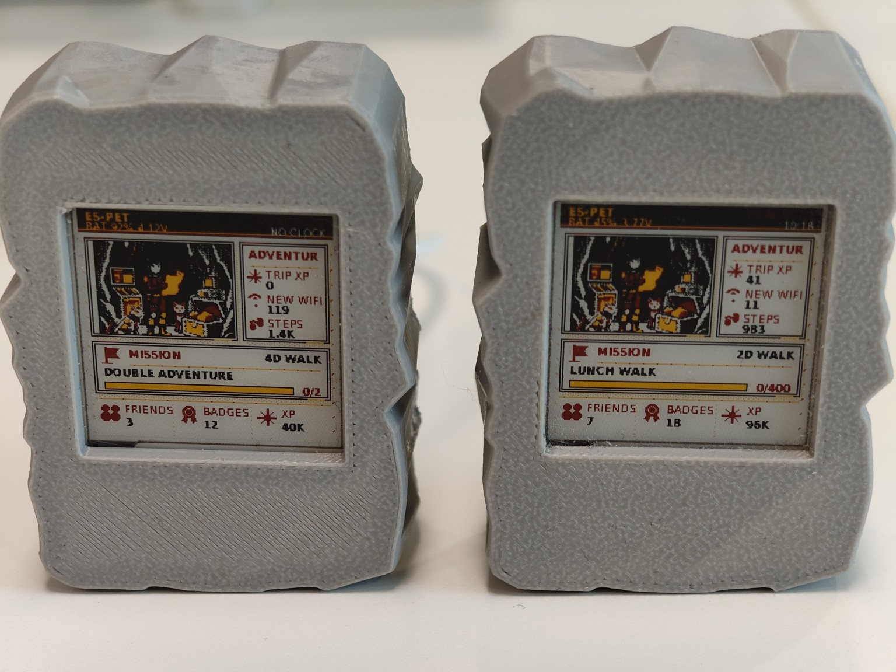
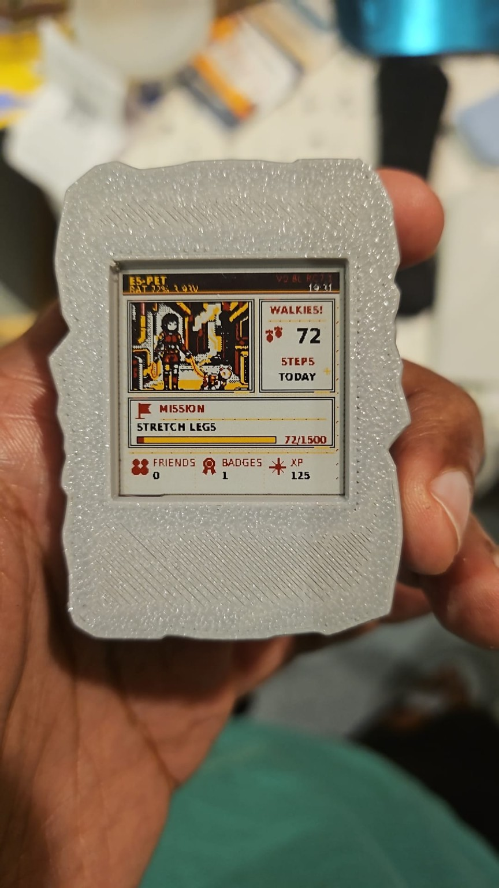
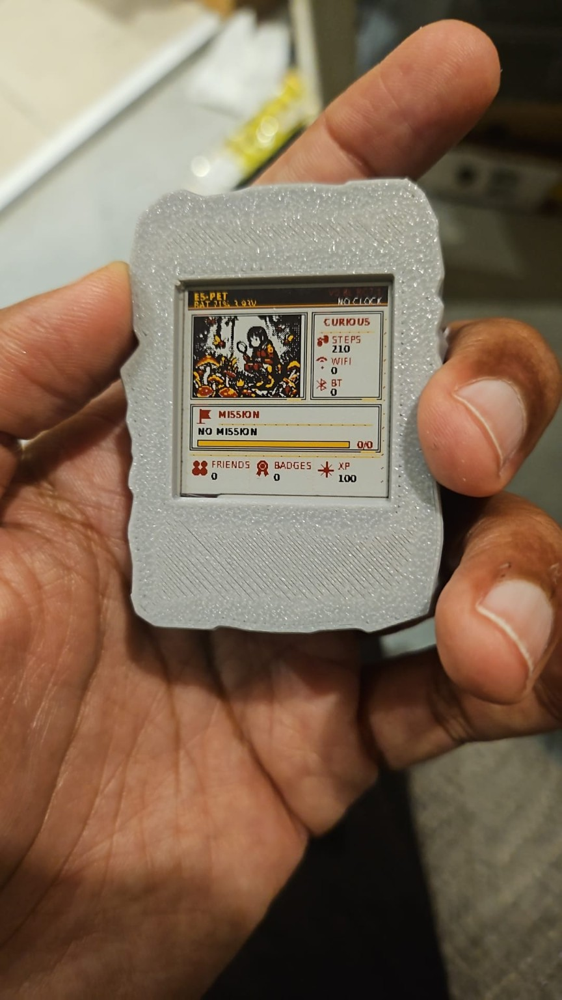
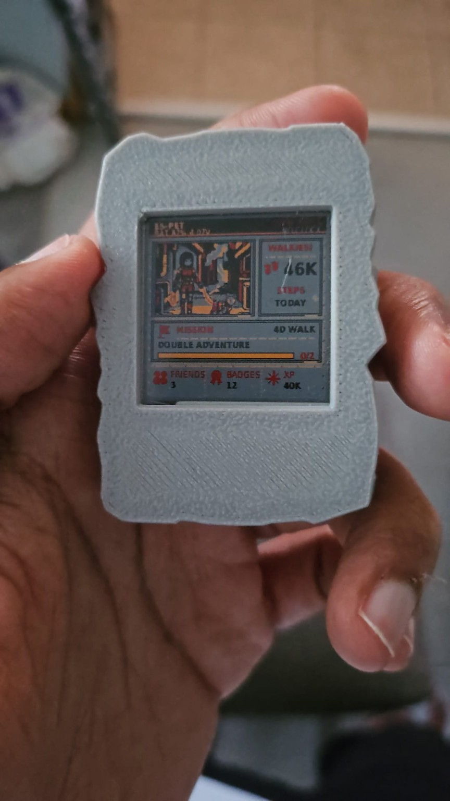

# ES-Pet Mini

An ESP32-C6 pocket virtual pet with a 1.54-inch e-paper display, motion sensing,
Wi-Fi exploration and Bluetooth encounters with other ES-Pets.

<p align="center">
  
</p>

Two finished Minis, each with its own steps, discoveries, friends and progress.

This repository publishes **V0.8L RC7**, from the source archive dated
25 September 2026. It includes the original source, artwork, project configuration,
host tests and release documentation. The firmware source is unchanged from that
archive. This publication did not compile or flash firmware.

## Start here

- [Player guide: missions, challenges and badges](RC7-PHONE-GUIDE.md)
- [Hardware and build instructions](#hardware)
- [RC6-to-RC7 migration](MIGRATION.md)
- [Original release verification](RELEASE-VERIFICATION.md)
- [Artwork](assets/)

The original release verification describes the earlier RC7 validation; it is
retained as historical release documentation. This upload contains no compiled
firmware images or case/STL files. Historical README files retain development
names such as Trimagotchi.

## Photos

| Walkies and daily mission | Curious screen | In-hand size |
|:---:|:---:|:---:|
|  |  |  |

## Licence and commercial use

**Free for personal, non-commercial builds. Commercial use outside the public
licences' permissions requires a separate written agreement.**

- **Software:** [PolyForm Noncommercial 1.0.0](LICENSES/PolyForm-Noncommercial-1.0.0.txt).
  Hobby use, modification and sharing are permitted under its terms, as are the
  educational, charitable and other organisational uses it expressly allows.
- **Original artwork, photographs and documentation:**
  [CC BY-NC 4.0](LICENSES/CC-BY-NC-4.0.txt), with credit to **yeahchap / ES-Pet Mini**.
- **Selling devices or kits using the project's firmware or artwork, or including
  it in a commercial product:** see [commercial licensing](COMMERCIAL-LICENSING.md)
  to discuss permission and an agreed fee or royalty before starting, unless the
  use is already permitted by the applicable public licence or law.

See [LICENSE.md](LICENSE.md) for scope and full terms. Third-party components,
including the font data, retain their own licences. ES-Pet Mini is **source
available for non-commercial use**.

## Third-party notices

The rasterised UI fonts derive from DejaVu Sans. See
[the font notice](THIRD_PARTY_NOTICES.md) and [the original asset note](assets/fonts-README.txt).

---

## V0.8L RC7 — Mission Economy

RC7 rebalances progression without taking anything away from an existing pet.
Its lifetime XP, Pet ID, HOME profile, friend books, steps, journeys, missions,
challenges, badges and diary remain in their RC6 locations and formats.

## What changes

- Wi-Fi and ordinary Bluetooth discovery XP share a **100 XP per local day**
  ceiling.
- Daily missions now pay **100, 150, 200 or 250 XP** according to effort.
- Completing all three daily missions pays an additional **200 XP** once.
- Meeting each genuinely new ES-PET peer pays **100 XP** outside the radio cap.
- Challenge and badge requirements/rewards are unchanged.
- Existing XP is never recalculated, reduced or reset. An 84K-XP RC6 pet keeps
  its 84K XP.

See [RC7-PHONE-GUIDE.md](RC7-PHONE-GUIDE.md) for the complete mission,
challenge and badge checklist.

## Release diagnostics policy

The RC7 release does not persist detailed XP-source history. It stores only
the current local date and the radio XP already paid that day, in the new NVS
namespace `trimecon`, so the 100-XP ceiling survives a reboot. Optional economy
tracing is serial-only, compile-time disabled (`ES_PET_ECONOMY_TRACE=0`) and
therefore absent from the release firmware.

## Hardware

- ESP32-C6 SuperMini, 4 MB flash
- WeAct 1.54-inch 200x200 display
- Four-colour JD79660/GDEM0154F51H when GPIO21 is HIGH/open
- Monochrome SSD1681/GDEH0154D67 when GPIO21 is LOW/GND
- Display: CLK4, MOSI6, CS7, DC3, RST2, BUSY5
- MPU-compatible IMU: SDA20, SCL19, INT14, address 0x68
- Optional haptic gate on GPIO1
- Optional battery divider on GPIO0

## Compatibility boundary

The RC6 partition map is unchanged:

| Data | Offset | Size |
|---|---:|---:|
| NVS | `0x009000` | `0x006000` |
| PHY | `0x00F000` | `0x001000` |
| App | `0x010000` | `0x300000` |
| Patch | `0x310000` | `0x002000` |
| Diary | `0x312000` | `0x0EE000` |

For an RC6 upgrade, write only the RC7 application image at `0x010000`.
Do not erase flash and do not rewrite the partition table. The full staged
procedure and recovery commands are in [MIGRATION.md](MIGRATION.md).

## Build

```bash
rm -rf .pio sdkconfig sdkconfig.old
pio run -e trimagotchi-c6
tests/run_host_tests.sh
```

The application image is produced at:

```text
.pio/build/trimagotchi-c6/firmware.bin
```

